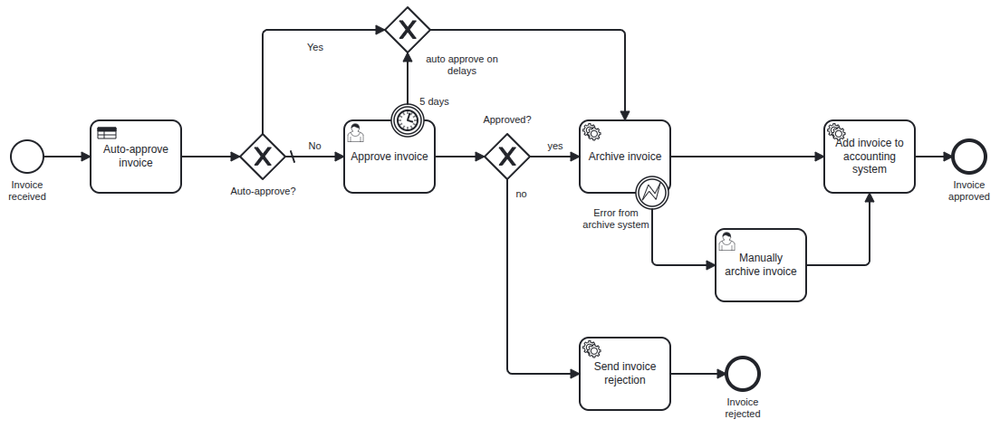

# CPT integration test demo

Demo for running [Camunda Process Test (CPT)](https://docs.camunda.io/docs/apis-tools/testing/getting-started/)
tests against an **already running Camunda 8 cluster**, while the **process application runs as a separate application**
that owns the process resources (BPMN, DMN) and hosts the job workers. It mimics the setup of an integration environment in
which the process application, the external services and custom connectors are deployed independently, and the process tests
verify the deployed process and invoke the real workers instead of mocking them.

> **Branch `main` — C8 Run `8.11.0-alpha1` with CPT `8.11.0-SNAPSHOT`.** Variations for the other versions live in the branches
> [`8.10`](../../tree/8.10) and [`8.9`](../../tree/8.9). What works in which version, the limitations and the
> recommended next steps are collected in **[docs/CAPABILITIES.md](docs/CAPABILITIES.md)**.
>
> How to set it up (cluster, process application, test project, configuration) — one blueprint per version: **[8.11](docs/blueprint-8.11.md)**, **[8.10](docs/blueprint-8.10.md)**, **[8.9](docs/blueprint-8.9.md)**.

## What is in here

```
.
├── process-application/  Spring Boot app: owns and deploys the BPMN and DMN, hosts the job workers (the "external services"). Started independently.
├── process-tests/        CPT tests (Java + JSON). Connects to a remote cluster. No process resources and no job workers inside.
├── docs/             Capabilities, limitations and version differences, a blueprint per version
└── .env.example      SaaS credentials template
```

The process is an invoice approval process with the DMN decision `auto-approve-invoice`. It is based on the invoice example of the
[CPT example project](https://github.com/camunda/camunda/tree/main/testing/camunda-process-test-example). 



Tests in `process-tests/src/test`:

| Test | Style | Covers |
| --- | --- | --- |
| `InvoiceApprovalTest` | Java | happy path, rejection, auto-approval (DMN), approval timeout (clock), archive error |
| `InvoiceDecisionTest` | Java, parameterized | the decision table, 7 rows |
| `InvoiceApprovalJsonTest` | JSON (`test-cases/*.json`, `test-cases-clock/*.json`) | the same paths and decision rows as JSON test cases |

## How it works

* **Remote runtime.** `camunda.process-test.runtime-mode: remote` makes CPT connect to the running cluster instead of
  starting a Testcontainers runtime. No Docker is needed. See
  [`process-tests/src/test/resources/application.yaml`](process-tests/src/test/resources/application.yaml).
* **The process application owns the resources.** The BPMN and DMN live in `process-application` and are deployed by it at startup
  (`@Deployment`). **The tests don't deploy anything**: they verify the process as deployed. That way a test run can't override what the process application has deployed.
* **Workers are external.** The tests neither start nor mock the job workers
  The tests assert the *effects*: the process path and the variables the workers return.
* **No cleanup, isolation by scoping.** CPT's default cleanup purges **all** data of the cluster after each test, 
  including the resources that the process application deployed — the tests would fail from the second test on.
  The tests therefore run with `camunda.process-test.data-deletion-mode: none` and rely on CPT's start-time scoping (8.10+): the queries only see
  the data that was created after the test case started.
* **Clock.** `increaseTime(Duration.ofDays(5))` (timer tests) uses the public clock API of the cluster (`/v2/clock`) with CPT 8.11.
  CPT ≤ 8.10 use the management API and need a cluster with a controllable clock instead. The timer
  tests are skipped for SaaS (`demo.clock-manipulation.enabled=false`), because of current limitations.
* **Versions.** The tests use the Camunda client and CPT of `cpt.version` (`8.11.0-SNAPSHOT`). 
  C8 Run and the process application use `camunda.version` (`8.11.0-alpha1`).

## Prerequisites

* Java 21 and Maven 3.9+
* The [c8 CLI](https://github.com/camunda/c8ctl) to install and run C8 Run: `npm install -g @camunda8/cli`
* For SaaS: a cluster and an API client (see [Run on Camunda 8 SaaS](#run-on-camunda-8-saas))

## Run on a local C8 Run (default)

**1. Start the cluster** with the c8 CLI. It downloads the version on the first start.

```bash
c8 cluster start 8.11.0-alpha1
```

No further setup is needed on this branch: CPT 8.11 changes the clock through the public clock API of the cluster. (CPT ≤ 8.10 and 8.11.0-alpha1 
use the management API and need `CAMUNDA_SYSTEM_CLOCKCONTROLLED=true` in the environment of the start command, see the `8.10` and `8.9` branches.)

**2. Start the process application** in a second terminal. It deploys the BPMN/DMN and runs the job workers. It keeps running across test runs.

```bash
mvn -pl process-application spring-boot:run
```

**3. Run the tests**

```bash
mvn -pl process-tests test
```

All 21 tests pass (5 Java process tests, 7 decision rows, 9 JSON test cases). The timer tests move the cluster clock.

A coverage report (HTML and JSON, BPMN and DMN) is written to `process-tests/target/coverage-report/report.html`. Open the HTML in a
browser to see which paths and decision rows were executed.

Then, stop the process application and the cluster. 

```bash
c8 cluster stop
```

## Run on Camunda 8 SaaS

SaaS has no management API (port 9600), so CPT can't purge the cluster. The `saas` profile therefore turns off the data
deletion (`data-deletion-mode: none`), increases the assertion timeout and skips the timer tests (Java and JSON). With the
snapshot CPT, the whole suite including the timer tests ran against a local cluster without the management API. On SaaS, the timer
tests did run, but moving the clock delays the Elasticsearch exporter by the size of the jump, so they stay off.

1. In the SaaS console create an API client (Cluster → API) with the scopes `Orchestration Cluster API`.
2. `cp .env.example .env`, fill in the values (the file is gitignored), and load them: `set -a; . .env; set +a`. For a stage other than production set
   `CAMUNDA_CLUSTER_DOMAIN` (for example `ultrawombat.com` for INT). The credentials file of the console (`export …`) works as well: `set -a; . <file>; set +a`.
 
   ```bash
   cp .env.example .env
   ```

3. Start the process application against SaaS (it stays running):

   ```bash
   set -a; . .env; set +a
   SPRING_PROFILES_ACTIVE=saas mvn -pl process-application spring-boot:run
   ```

4. Run the tests against SaaS:

   ```bash
   set -a; . .env; set +a
   mvn -pl process-tests test -Psaas
   ```

> Status: verified on 8.11 only — against a cluster on the Camunda INT stage (`CAMUNDA_CLUSTER_DOMAIN=ultrawombat.com`, 8.11.0-alpha1) with the
> snapshot CPT: 19 of 21 tests pass (the 2 timer tests are skipped), also a second run on top of the data of the first. **Don't enable the timer tests on
> SaaS**: `increaseTime` delays the Elasticsearch exporter by the size of the jump. See the limitations in [docs/CAPABILITIES.md](docs/CAPABILITIES.md).

## Continuous integration

The workflow [`.github/workflows/test.yml`](.github/workflows/test.yml) runs the tests of this branch (8.11) on pull requests and on pushes to `main`.
You can also start it manually (*Actions → Process tests → Run workflow*). It does what the steps above do on a fresh runner: it installs the c8 CLI, starts
C8 Run `8.11.0-alpha1`, starts the process application in the background and runs the tests. Each run has its own cluster, so runs don't disturb each other.

Artifacts of a run (also when the tests fail):

| Artifact | Content |
| --- | --- |
| `test-results` | The surefire reports (XML, text, and the test output per class as `*-output.txt`) and the Maven log. |
| `coverage-report` | The CPT coverage report (`report.html`, `report.json`). |
| `logs` | The logs of the process application and of C8 Run, for troubleshooting. |

## Configuration reference

| What | Where |
| --- | --- |
| Remote runtime, addresses, timeouts | `process-tests/src/test/resources/application.yaml` |
| SaaS overrides | `process-tests/src/test/resources/application-saas.yaml` |
| Process application: connection (C8 Run / SaaS) | `process-application/src/main/resources/application*.yaml` |
| Camunda version of the branch | `camunda.version` in the root `pom.xml` |

Any property can be overridden on the command line, for example
`mvn -pl process-tests test -Dcamunda.process-test.assertion.timeout=PT30S`.

## Troubleshooting

| Symptom | Cause / fix |
| --- | --- |
| `Failed to connect to remote Camunda runtime` | The cluster is not running or not ready, or the addresses are wrong. Check `c8 cluster status`. |
| Timer test fails: *clock is immutable* / 403 | Only with the 8.11.0-alpha1 CPT or CPT ≤ 8.10 (the `8.10`/`8.9` branches): the cluster was started without `CAMUNDA_SYSTEM_CLOCKCONTROLLED=true`. Restart it with the variable. |
| `Cluster is unhealthy` before a test | Known issue after `increaseTime` with `data-deletion-mode=none` and CPT ≤ 8.10 / the alpha1. Reset the clock (`curl -X DELETE localhost:9600/actuator/clock`), purge (`curl -X POST localhost:9600/actuator/cluster/purge`) or restart the cluster. |
| `Command 'CREATE' rejected with code 'NOT_FOUND': Expected to find process definition with process ID 'Process_InvoiceApproval', but none found` | The process application has not deployed the resources. Start it first (it deploys the BPMN/DMN). Also happens after a purge of the cluster: restart the process application. |
| Assertions time out waiting for a step | The process application (workers) is not running, or runs against another cluster. Check its log. |
